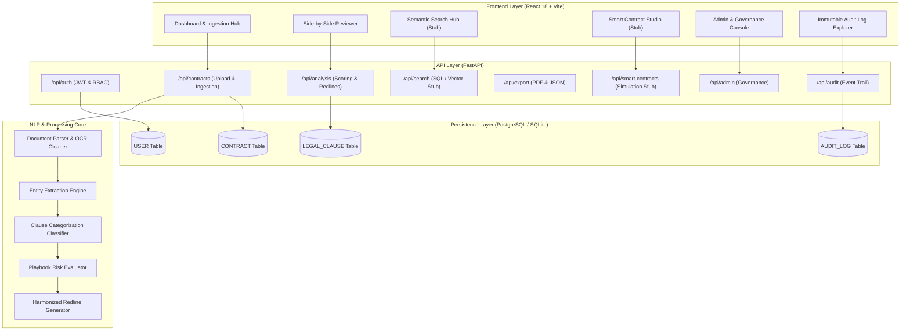
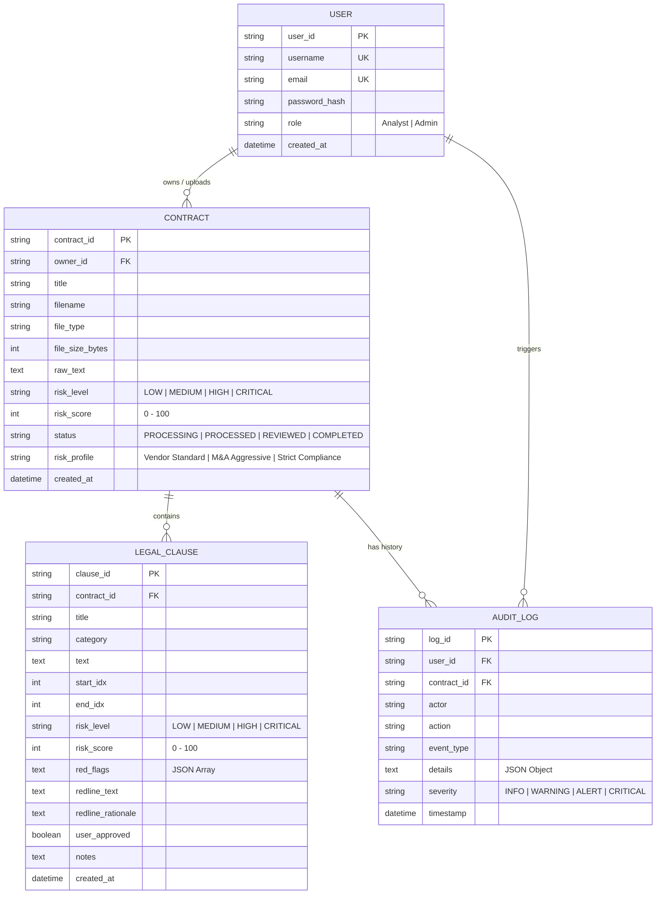

# LegalSight — AI Contract Review & Risk Intelligence Engine

LegalSight is an automated contract intelligence and review platform designed for corporate legal departments, commercial counsel, and procurement teams. The system ingests legal agreements (PDF/DOCX/TXT), performs text extraction and OCR normalization, extracts critical legal entities, classifies clauses into standard legal categories, evaluates multi-factor contract risk against customizable playbooks, drafts harmonized redlines, and presents the findings in a side-by-side interactive document reviewer.

---

## System Architecture



---

## Entity Relationship Diagram (ERD)



---

## Implementation Summary (Completed Scope)

### 1. Database & Persistence Layer
- **SQLAlchemy ORM Integration**: Supports PostgreSQL in production (`DATABASE_URL`) and SQLite (`legalsight.db`) for zero-configuration local development.
- **Relational Models**:
  - `USER`: Authentication, password hashing, and role-based access controls.
  - `CONTRACT`: Document metadata, parsed text, file dimensions, and overall risk levels.
  - `LEGAL_CLAUSE`: Segmented legal provisions, risk scores, red flags, and redlines.
  - `AUDIT_LOG`: Immutable audit trail tracking logins, file uploads, reviews, edits, and exports.

### 2. Authentication & Role-Based Access Control (RBAC)
- **JSON Web Tokens (JWT)**: Secure HS256 token generation with expiration tracking.
- **Password Security**: Salted PBKDF2-HMAC-SHA256 password hashing.
- **Pre-Seeded Demo Accounts**:
  - Analyst: `analyst@legalsight.ai` (Password: `password123`)
  - Admin: `admin@legalsight.ai` (Password: `password123`)
- **FastAPI Dependencies**: `get_current_user`, `require_auth`, and `require_admin`.

### 3. Document Ingestion & OCR Sanitization
- **Multi-Format Parsing**:
  - Digital PDF stream extraction via `pypdf`.
  - Scanned PDF fallback hook utilizing image extraction and Tesseract OCR (`pytesseract` + `PIL`).
  - Word Document (`.docx`) OpenXML paragraph and table parser via `python-docx`.
  - Plain text and markdown (`.txt`, `.md`) ingestion.
- **OCR Normalization Engine**: De-hyphenates words broken across line breaks (`in-\n demnify` -> `indemnify`), standardizes line endings, and normalizes paragraph breaks.
- **Pre-Loaded Multi-Risk Test Corpus**:
  - Enterprise Cloud SaaS Master Services Agreement (MSA)
  - Cross-Border M&A Share Purchase Agreement (SPA)
  - Mutual Non-Disclosure & Non-Circumvention Agreement (NDA)

### 4. NLP & Contract Analysis Engine
- **Named Entity Recognition (NER)**:
  - Parties and corporate designations (LLC, Inc., Corp., PLC, S.A.).
  - Effective dates and execution dates.
  - Monetary values, super-caps, and escrow commitments.
  - Governing law jurisdictions (State of Delaware, State of New York, English Law).
  - Dispute resolution venues and arbitration tribunals (AAA, LCIA, High Court of Justice).
- **Clause Categorization**: Identifies Indemnity, Limitation of Liability, Termination, Confidentiality, Non-Compete, Intellectual Property, Data Privacy (GDPR/SOC2), and Commercial Terms.
- **Playbook Risk Evaluator**: Calculates risk score (0 to 100) and assigns severity levels (`LOW`, `MEDIUM`, `HIGH`, `CRITICAL`) across four selectable playbooks:
  - Vendor Standard
  - M&A Aggressive
  - Strict Compliance
  - Balanced Commercial
- **Harmonized Redline Generator**: Detects anti-patterns (uncapped liability, unilateral termination for convenience, perpetual confidentiality, broad non-competes) and drafts reciprocal, market-aligned replacements with legal rationales.

### 5. Side-by-Side Reviewer UI (React + Vite)
- **Split-Pane Reviewer**:
  - **Left Pane (Source Document)**: Document reader with line numbers, search within contract, and interactive jump anchors.
  - **Right Pane (Intelligence Console)**:
    - *Risk Scorecard*: Radial gauge (0-100), executive summary, risk category bars, and counsel recommendations.
    - *Key Entities*: Grouped entity tags with click-to-highlight functionality.
    - *Clauses & Redlines*: Categorized clauses with risk badges, red flags, side-by-side original vs. suggested redline diffs, custom redline editor, and clause approval toggles.
    - *Audit Trail*: Real-time contract-specific event ledger.
  - **Top Action Bar**: Instant risk playbook re-evaluation, ReportLab Executive Summary PDF export, JSON analysis export, and final review sign-off.
- **Theme & Aesthetics**: Warm off-white and cream palette (`#f7f5f0` canvas, `#fdfcf9` cards, `#1c1917` typography) with soft Red-Yellow-Green (RYG) status indicators.

### 6. Downstream Extension Points & Stubs
- **Semantic Search Hub (`/api/search`)**: Text search over contracts and clauses with similarity matching metrics, ready for Pinecone or FAISS vector database integration.
- **Smart Contracts Studio (`/api/smart-contracts`)**: `SmartContract`, `ExecutionRule`, `PaymentTrigger`, and `Milestone` classes with automated rule synthesis and simulated Ethereum Sepolia deployment.
- **Admin & Governance Console (`/api/admin`)**: User account management with role badges, plus placeholder settings for Playbook customization and NLP fine-tuning.
- **Reporting Stubs (`/api/reports`)**: `LegalReport` portfolio liability overview and `DeadlineTracker` notification schedules.

---

## Recommended Open-Source Legal Datasets

To expand LegalSight beyond heuristic baselines and train custom zero-shot or fine-tuned Transformer models (such as RoBERTa-Legal or Legal-BERT), the following open-source datasets are recommended:

### 1. CUAD (Contract Understanding Atticus Dataset)
- **Source**: The Atticus Project / Stanford University
- **Size**: 510 commercial contracts, 13,000+ annotations across 41 legal categories.
- **License**: CC BY 4.0
- **Relevance to LegalSight**: Standard benchmark for contract review. It maps directly to LegalSight clause categories (Indemnification, Limitation of Liability, Termination for Convenience, Non-Compete, Governing Law).
- **Integration Point**: Fine-tuning the clause segmentation and category classification model.

### 2. MAUD (Merger Agreement Understanding Dataset)
- **Source**: The Atticus Project
- **Size**: 152 M&A deals containing over 39,000 question-answer annotations across 92 Deal Point categories.
- **License**: CC BY 4.0
- **Relevance to LegalSight**: Enhances the M&A Aggressive playbook by training the system to evaluate representations, warranties, material adverse effect (MAE) clauses, and escrow indemnity baskets.
- **Integration Point**: Specialized risk scoring for M&A Share Purchase Agreements (SPAs).

### 3. LEDGAR (Legal Document Clause Classification Dataset)
- **Source**: Chalkidis et al. / Hugging Face Datasets
- **Size**: 846,000+ contract provisions from SEC EDGAR filings classified across 100 legal topics.
- **License**: CC BY-NC-SA 4.0
- **Relevance to LegalSight**: Large-scale clause classification training. Provides high statistical support for standard boilerplate and operational provisions.
- **Integration Point**: Zero-shot and supervised multi-class clause classifier.

### 4. ContractNLI (Natural Language Inference for Contracts)
- **Source**: Koreeda and Manning / Stanford NLP
- **Size**: Multi-document NLI dataset for Non-Disclosure Agreements (NDAs).
- **License**: CC BY 4.0
- **Relevance to LegalSight**: Validates compliance against negative constraints (e.g., verifying whether a contract violates confidentiality, non-solicitation, or reverse-engineering covenants).
- **Integration Point**: Playbook compliance rule validation and automated redline generation.

### 5. SEC EDGAR Form 10-K & Material Contracts Exhibit 10
- **Source**: US Securities and Exchange Commission (SEC)
- **Size**: 500,000+ publicly filed commercial agreements (MSAs, SPAs, Credit Agreements, IP Licenses).
- **License**: Public Domain (US Government)
- **Relevance to LegalSight**: Unsupervised pre-training and vector database population for market precedent retrieval.
- **Integration Point**: Powering the Precedent Retrieval Engine and semantic similarity comparisons.

---

## Project Structure

```
LegalSight/
├── backend/
│   ├── app/
│   │   ├── api/
│   │   │   ├── auth.py              # JWT signup, login, and user profile verification
│   │   │   ├── contracts.py         # Ingestion, file upload, sample loading, and listing
│   │   │   ├── analysis.py          # Job state, clause approval, redline modification, re-evaluate
│   │   │   ├── audit.py             # Audit trail querying and compliance alerts
│   │   │   ├── export.py            # PDF executive report and JSON summary downloads
│   │   │   ├── search.py            # Semantic search stub interface
│   │   │   ├── smart_contracts.py   # Smart contract drafting & blockchain simulation stub
│   │   │   ├── admin.py             # User listing and playbook governance stubs
│   │   │   ├── precedents.py        # Precedent clause search
│   │   │   ├── knowledge_graph.py   # Topological graph node/edge builder
│   │   │   └── ws.py                # Real-time WebSocket connection router
│   │   ├── db/
│   │   │   ├── database.py          # SQLAlchemy engine and session dependency
│   │   │   └── models.py            # User, Contract, LegalClause, and AuditLog schema models
│   │   ├── models/
│   │   │   └── schemas.py           # Pydantic schemas for data validation
│   │   ├── sample_contracts/
│   │   │   └── contracts.py         # Multi-risk realistic sample contract corpus
│   │   ├── services/
│   │   │   ├── auth_service.py      # PBKDF2 password hashing and JWT token generator
│   │   │   ├── parser.py            # PDF (with OCR fallback), DOCX, and TXT parsing
│   │   │   ├── nlp_engine.py        # Named Entity Recognition and clause classifier
│   │   │   ├── risk_evaluator.py    # Playbook risk scoring and redline synthesis
│   │   │   ├── orchestrator.py      # Ingestion pipeline controller and DB persistence
│   │   │   ├── audit_service.py     # Immutable event logging service
│   │   │   ├── export_service.py    # ReportLab PDF executive summary generator
│   │   │   ├── vector_store.py      # Precedent matching vector index
│   │   │   └── smart_contract_stub.py # Smart contract execution classes
│   │   ├── config.py                # Application environment configuration
│   │   └── main.py                  # FastAPI application entrypoint and lifespan hooks
│   ├── tests/
│   │   └── test_api.py              # Automated test suite (8 tests)
│   └── requirements.txt             # Python backend dependencies
│
└── frontend/
    ├── index.html                   # HTML entrypoint with typography fonts
    ├── vite.config.js               # Vite configuration with backend API proxy
    ├── package.json                 # React 18, Vite, and Lucide Icons dependencies
    └── src/
        ├── App.jsx                  # Main application routing and state hub
        ├── index.css                # Warm off-white & cream design system
        ├── api/
        │   └── client.js            # Centralized API fetch wrapper and token management
        └── components/
            ├── Header.jsx           # Top navigation bar with role tags and auth status
            ├── AuthModal.jsx        # Sign in / Sign up modal with 1-click demo logins
            ├── Dashboard.jsx        # Drag-and-drop dropzone, sample loaders, repository table
            ├── Reviewer.jsx         # Split-pane side-by-side reviewer container
            ├── DocumentPane.jsx     # Left pane: numbered source text viewer with search
            ├── RiskRadar.jsx        # Right pane: risk score gauge, category bars, recommendations
            ├── EntityList.jsx       # Right pane: grouped entity chips with jump-to-doc
            ├── ClauseCard.jsx       # Right pane: categorized clause, red flags, redline diff
            ├── SearchHub.jsx        # Semantic search interface with category/risk filters
            ├── SmartContractStudio.jsx # Smart contract synthesis and deployment simulator
            ├── AdminConsole.jsx     # User management table and playbook governance panels
            └── AuditLogViewer.jsx   # Dedicated immutable audit trail explorer
```

---

## Getting Started

### Prerequisites
- Python 3.10+
- Node.js 18+ and npm

### 1. Backend Setup
```bash
cd backend
python -m pip install -r requirements.txt
python -m uvicorn app.main:app --port 8000 --reload
```
- Backend API Root: `http://127.0.0.1:8000/`
- Interactive OpenAPI Swagger Docs: `http://127.0.0.1:8000/docs`

### 2. Frontend Setup
```bash
cd frontend
npm install
npm run dev
```
- Web Application: `http://localhost:5173/`

### 3. Running Automated Tests
```bash
cd backend
python -m pytest
```

---

## API Endpoints Reference

| Method | Endpoint | Description | Access |
| :--- | :--- | :--- | :--- |
| `POST` | `/api/auth/signup` | Register new user account | Public |
| `POST` | `/api/auth/login` | Authenticate credentials & return JWT | Public |
| `GET` | `/api/auth/me` | Fetch authenticated user profile | Authenticated |
| `GET` | `/api/contracts` | List all ingested contracts in repository | Authenticated / Public |
| `POST` | `/api/contracts/upload` | Upload PDF/DOCX contract for analysis | Authenticated / Public |
| `POST` | `/api/contracts/load-sample/{key}` | Load and analyze pre-configured sample | Authenticated / Public |
| `GET` | `/api/contracts/{id}` | Retrieve contract metadata & raw text | Authenticated / Public |
| `GET` | `/api/analysis/job/{job_id}` | Fetch full analysis state (entities, clauses, risk) | Authenticated / Public |
| `POST` | `/api/analysis/job/{id}/re-evaluate` | Switch risk playbook & re-calculate scores | Authenticated / Public |
| `POST` | `/api/analysis/job/{id}/clause/{cid}/approve` | Toggle clause approval in review | Authenticated / Public |
| `POST` | `/api/analysis/job/{id}/clause/{cid}/redline` | Save custom redline replacement text | Authenticated / Public |
| `POST` | `/api/analysis/job/{id}/finalize` | Trigger final sign-off & commit to database | Authenticated / Public |
| `GET` | `/api/export/pdf/{id}` | Download Executive Summary PDF report | Authenticated / Public |
| `GET` | `/api/export/summary/{id}` | Download analysis payload as JSON | Authenticated / Public |
| `GET` | `/api/search` | Search contracts & clauses (Vector stub) | Authenticated / Public |
| `POST` | `/api/smart-contracts/draft/{id}` | Compile automated smart contract rules | Authenticated / Public |
| `POST` | `/api/smart-contracts/deploy/{id}` | Simulate deployment to Sepolia testnet | Authenticated / Public |
| `GET` | `/api/admin/users` | List registered platform user accounts | Admin |
| `GET` | `/api/admin/playbooks` | Retrieve playbook settings (Stub) | Admin |
| `GET` | `/api/audit/events` | Query immutable audit log records | Authenticated / Public |
